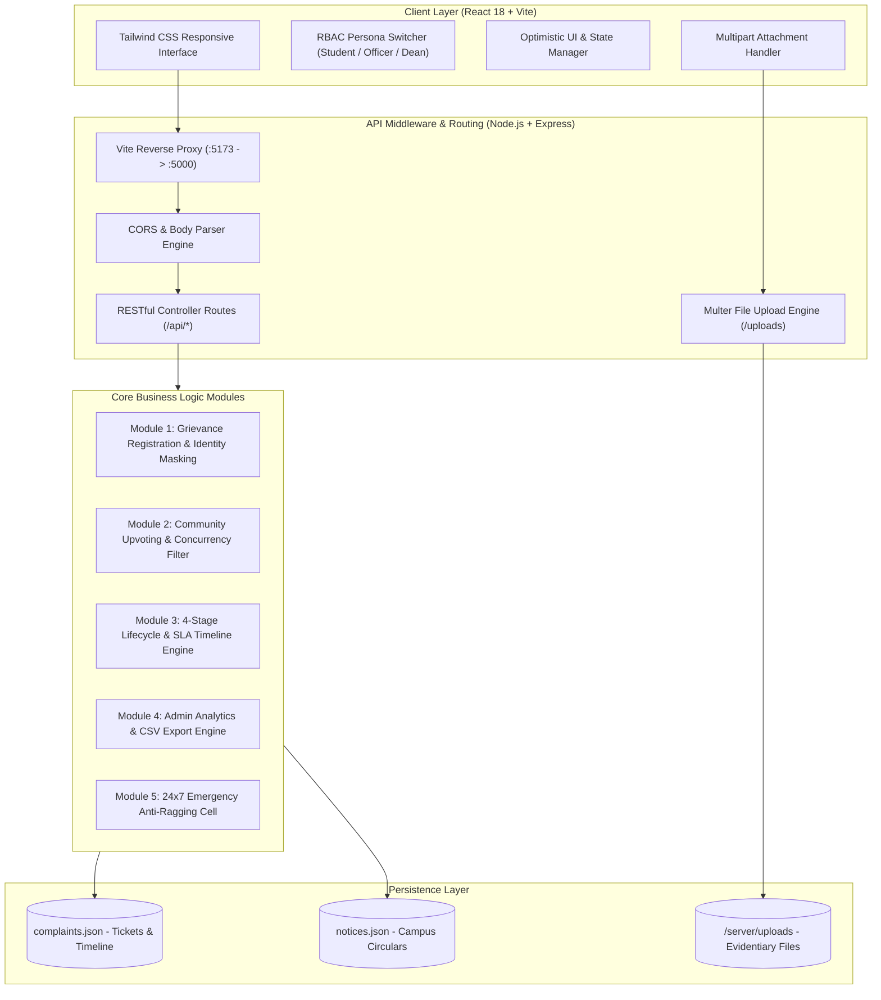
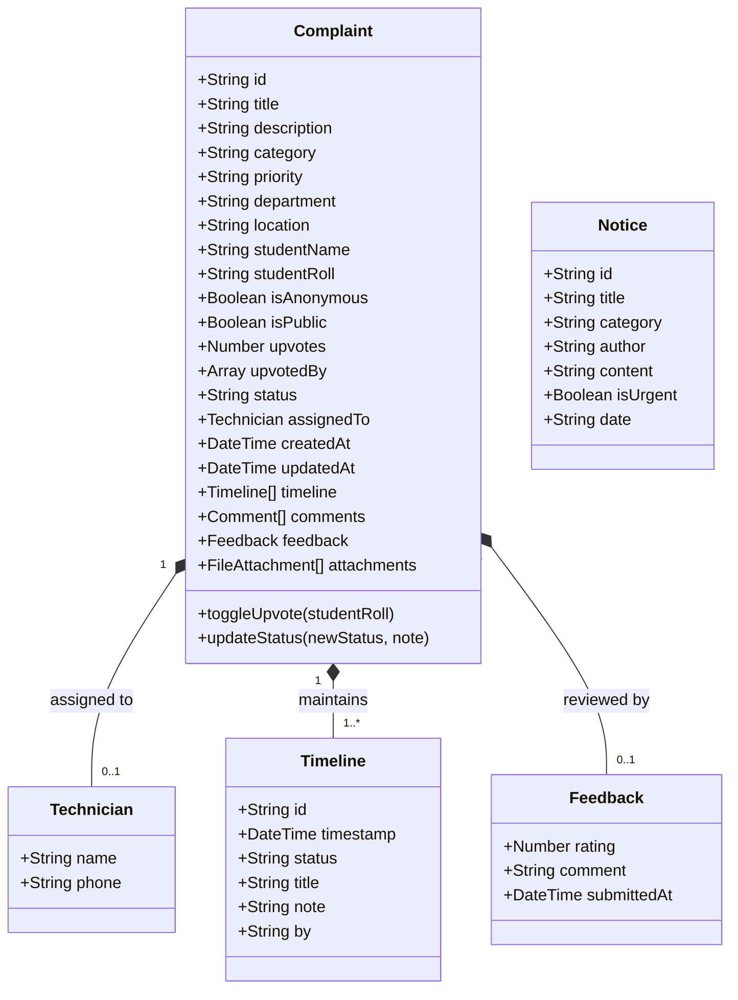
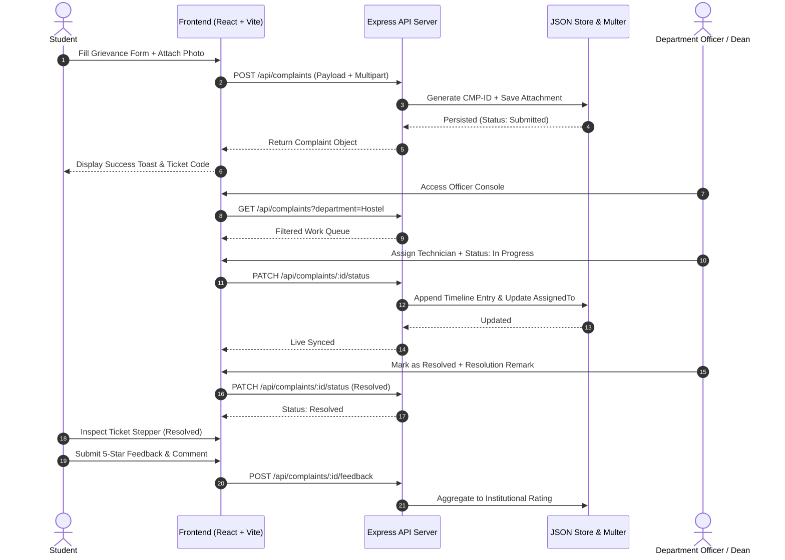
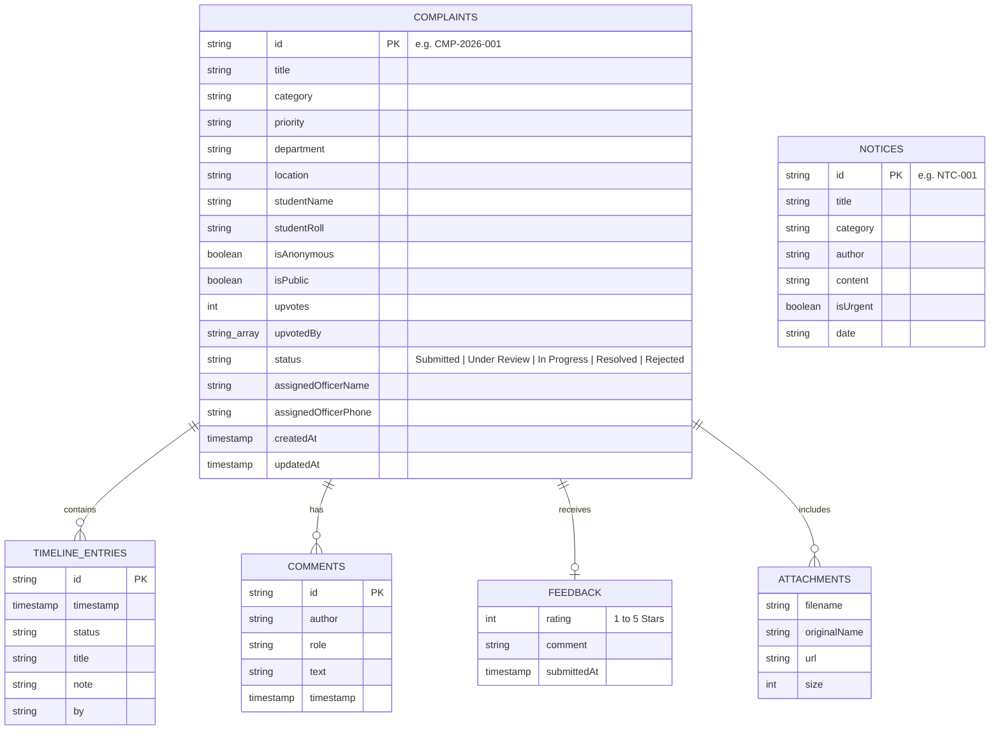

# 🎓 College Complaints Portal: Digital Grievance Redressal & Institutional Maintenance Platform

> An enterprise-grade, transparent, and UGC / AICTE-compliant **College Grievance Redressal and Maintenance Management System** engineered for technical universities, colleges, and residential campuses.

---

## 📌 Project Administration (Week 1)

**Project Guide:** Er. Ram Babu Buri  
* **Designation:** Assistant Professor, Department of Artificial Intelligence & Data Science
* **Institution:** Arya College of Engineering & IT (ACEIT), Jaipur (Affiliated to Rajasthan Technical University, Kota)
* **Research Area:** Machine Learning & Data Science
* **Specializations:** Java, JSP–Servlet, Spring Boot, MySQL, Python, Web Engineering

### Engineering Team

| Name | Role | Department | Academic Session |
| :--- | :--- | :--- | :--- |
| **Jatin (Lead)** | Full-Stack Architect & Project Lead | Artificial Intelligence & Data Science | 2026-27 |
| **Manish** | Backend API & Database Engineer | Artificial Intelligence & Data Science | 2026-27 |
| **Pradeep Kumar Meena** | Frontend UI/UX & React Developer | Artificial Intelligence & Data Science | 2026-27 |
| **Pradeep** | Testing, Integration & Quality Assurance | Artificial Intelligence & Data Science | 2026-27 |
| **Kapil Beniwal** | Compliance, SLA & Documentation | Artificial Intelligence & Data Science | 2026-27 |

---

## 📄 Abstract

Traditional higher educational institutions in India face substantial challenges in tracking and resolving campus maintenance issues, residential hostel grievances, and student welfare concerns. Outdated manual complaint registers, lack of Service Level Agreements (SLAs), and paper-bound bureaucratic workflows result in delayed resolution times, loss of critical records, and complete opacity for students. Furthermore, sensitive matters—such as campus ragging, harassment, or faculty evaluation bias—often go unreported due to compulsory physical signatures and fear of academic retribution.

To resolve these systematic bottlenecks, **College Complaints Portal** introduces an end-to-end, digital, full-stack grievance redressal ecosystem. Developed adhering to the statutory requirements of the **University Grants Commission (UGC)** and **All India Council for Technical Education (AICTE)**, the platform establishes a transparent, accountable, and auditable bridge connecting students, departmental officers, and senior institutional authorities (Dean of Student Affairs / Chief Proctor).

The system integrates a three-tier Role-Based Access Control (RBAC) architecture built on **React 18** and **Vite** for the client application and a resilient **Node.js Express** RESTful API backend. It features an automated 4-stage resolution stepper (`Submitted` ➔ `Under Review` ➔ `In Progress` ➔ `Resolved`) with immutable audit trails. To prevent ticket duplication and prioritize pressing campus emergencies, the portal introduces a democratic **Community Upvoting Engine** where affected scholars can endorse common complaints (e.g., campus Wi-Fi failure or water cooler breakdown). Crucially, the platform guarantees complete identity protection via an encrypted **Anonymous Lodging Mode** alongside a 24x7 **Emergency SOS Anti-Ragging Cell**. The resulting system eliminates administrative backlog, enforces strict departmental turnaround times, and provides senior leadership with real-time analytics and one-click audit reports.

---

## 👥 User Roles & Access Hierarchy (Week 2)

The platform enforces strict Role-Based Access Control (RBAC) across three distinct organizational personas:

* **1. Student Complainant**:
  * Lodge grievances across 10+ campus categories (Hostel, Mess, Academics, Labs, Sanitation, Security, Anti-Ragging).
  * Toggle **Confidential / Anonymous Mode** to suppress personal identity on public feeds and staff views.
  * Upload visual evidence (photos/documents up to 10MB) via integrated Multer multipart engine.
  * Upvote (`+1`) common campus issues and participate in discussion threads.
  * Track tickets through an interactive 4-stage lifecycle timeline.
  * Submit verified 1 to 5-star resolution feedback and quality reviews once marked resolved.

* **2. Department Officer / Resolver**:
  * Specialized queue filtered by jurisdiction (Hostel & Estate, IT & Network, Mess Committee, Proctorial Board).
  * Assign ground technicians (electricians, plumbers, AV technicians) with direct contact details.
  * Transition ticket lifecycle states (`Under Review`, `In Progress`, `Resolved`, `Rejected`).
  * Record official corrective action remarks visible to the student.
  * Broadcast emergency maintenance circulars on the campus bulletin board.

* **3. Dean / Administrator**:
  * Institutional oversight dashboard with real-time Key Performance Indicators (KPIs).
  * Domain-wise complaint distribution analytics and department workload balancing.
  * Track institute-wide student satisfaction index (e.g., 4.8 / 5.0 ⭐).
  * One-click export of complete grievance audit trails to CSV/Excel format.
  * Immediate notification and oversight of High-Priority Emergency SOS and Anti-Ragging alerts.

---

## 📚 Project Deliverables & Defense Resources

* 📽️ **Official Project Presentation (PPTX):** [`College_Complaints_Portal_Presentation.pptx`](./College_Complaints_Portal_Presentation.pptx)  
  *(12-slide comprehensive presentation with professional dark navy theme, presenter notes, and team credits)*
* 📄 **Viva-Voce Q&A Preparation Guide (PDF):** [`College_Complaints_Portal_Viva_Questions_Answers.pdf`](./College_Complaints_Portal_Viva_Questions_Answers.pdf)  
  *(Comprehensive 21 Q&A defense document covering architecture, security, REST API, and examiner checklist)*
* 🔗 **Live GitHub Repository:** [`https://github.com/jatinbaghel7014-tech/collage-complaints-portal`](https://github.com/jatinbaghel7014-tech/collage-complaints-portal)

---

## 🏛️ System Architecture & Core Modules

The platform is designed around a distributed full-stack architecture comprising a modular client, stateless REST services, and persistent atomic data stores.



### Functional Modules:

* **Module 1: Identity Protection & Grievance Lodging Engine**  
  Captures complaint parameters (title, category, priority, exact room/block location). If anonymity is requested, identity parameters are sealed on the backend, ensuring public feeds and resolvers only view a randomized hash or "Anonymous Student".

* **Module 2: Community Upvoting & Deduplication**  
  Maintains an atomic `upvotedBy` array of student roll numbers. Enables scholars to endorse existing issues, eliminating redundant complaint logging and dynamically sorting high-impact grievances to the top of administrative queues.

* **Module 3: 4-Stage Resolution Lifecycle & Immutable Audit Trail**  
  Transitions grievances sequentially (`Submitted` ➔ `Under Review` ➔ `In Progress` ➔ `Resolved`). Every state transition generates an immutable timeline entry recording the ISO timestamp, acting official, and resolution note.

* **Module 4: Administrative Intelligence & CSV Export Engine**  
  Computes aggregated institutional metrics (resolution rates, pending vs resolved ratios, domain distribution). Includes client-side programmatic CSV conversion for regulatory reporting.

* **Module 5: 24x7 Emergency Anti-Ragging & Safety Cell**  
  Provides instantaneous access to statutory helplines (UGC Anti-Ragging `1800-180-5522`, Chief Proctor, Women Safety ICC, Campus Ambulance) with one-click copy and direct call triggers.

---

## 🔒 Non-Functional Requirements (NFR)

* **Performance**: Sub-second API response time (< 50ms) for grievance retrieval and status filtering. Optimistic UI updates in React provide instantaneous feedback during upvoting.
* **Security & Privacy**: Zero plaintext leakage of anonymous student records. File uploads are strictly restricted to 10MB with cryptographic filename hashing to prevent path traversal attacks.
* **Fault Tolerance & Reliability**: Atomic file write routines prevent data corruption during simultaneous user write requests. Graceful fallback states for empty searches or network interruptions.
* **Portability & Zero Configuration**: Designed to run on any environment possessing Node.js 18+ without requiring external database server installations, with clear abstraction for MongoDB/PostgreSQL migration.

---

## 📐 UML Design & Visual Workflows (Week 3)

### Class Diagram



### Grievance Redressal Sequence Diagram



---

## 🗄️ Database Architecture & Entity-Relationship Schema (Week 4)

The platform utilizes a document-oriented persistence model structured for high read-throughput and zero schema migration complexity.

### Entity-Relationship (ER) Diagram



---

## 📡 RESTful API Endpoint Specifications

| Method | Endpoint | Description | Request Body / Parameters |
| :--- | :--- | :--- | :--- |
| `GET` | `/api/health` | Service health & uptime verification | None |
| `GET` | `/api/complaints` | Fetch complaints with dynamic filters | Query: `status`, `category`, `priority`, `department`, `search` |
| `GET` | `/api/complaints/:id` | Fetch complete ticket details & timeline | Param: `id` (e.g. `CMP-2026-001`) |
| `POST` | `/api/complaints` | Lodge new grievance | JSON: `{ title, description, category, priority, location, isAnonymous, ... }` |
| `PATCH`| `/api/complaints/:id/status`| Update status & assign technician | JSON: `{ status, assignedTo, note, updatedBy }` |
| `POST` | `/api/complaints/:id/upvote`| Toggle community upvote | JSON: `{ studentRoll }` |
| `POST` | `/api/complaints/:id/comments`| Post discussion comment | JSON: `{ author, role, text }` |
| `POST` | `/api/complaints/:id/feedback`| Submit 1-5 star resolution rating | JSON: `{ rating, comment }` |
| `GET` | `/api/stats` | Compute institutional KPI analytics | None |
| `GET` | `/api/notices` | Fetch official campus circulars | None |
| `POST` | `/api/notices` | Broadcast administrative notice | JSON: `{ title, content, category, isUrgent, author }` |
| `GET` | `/api/emergency-contacts`| Retrieve 24x7 safety numbers | None |
| `POST` | `/api/upload` | Upload supporting photo/document | `multipart/form-data` (Key: `attachment`) |

---

## 📂 Project Directory Structure (Week 5)

```text
college-complaints-portal/
│
├── README.md                                          # Official Academic Documentation
├── College_Complaints_Portal_Presentation.pptx         # 12-Slide Dark Theme Defense PPT
├── College_Complaints_Portal_Viva_Questions_Answers.pdf# 21-Question Viva Guide
├── generate_ppt.js                                    # Automated PPTX Generation Engine
├── generate_viva_pdf.js                               # Automated PDF Generation Engine
├── package.json                                       # Root Orchestrator & Dependencies
├── package-lock.json                                  # Dependency Integrity Lockfile
│
├── server/                                            # Express REST API Backend
│   ├── server.js                                      # API Server, Routes, Static Host (:5000)
│   ├── data/
│   │   ├── complaints.json                            # Persistent Complaints Data Store
│   │   └── notices.json                               # Campus Circulars Data Store
│   └── uploads/                                       # Uploaded Student Evidence Files
│
└── client/                                            # React 18 Single-Page Application
    ├── package.json                                   # Client Dependencies (Lucide, Tailwind, React)
    ├── vite.config.js                                 # Vite Bundler & Dev Reverse Proxy Configuration
    ├── tailwind.config.js                             # Tailwind CSS Theme Extensions
    ├── postcss.config.js                              # PostCSS Configuration
    ├── index.html                                     # HTML5 Entry Point with Google Fonts
    └── src/
        ├── main.jsx                                   # React Root Mount
        ├── App.jsx                                    # Core State Container & Tab Router
        ├── index.css                                  # Tailwind Directives & Custom Scrollbars
        ├── constants.js                               # Categories, Statuses, Priority Color Matrix
        └── components/
            ├── Navbar.jsx                             # Brand Header & RBAC Role Switcher
            ├── ComplaintCard.jsx                      # Grievance Feed Card with Upvote Button
            ├── NewComplaintModal.jsx                  # Grievance Submission Form with Anonymity
            ├── ComplaintDetailModal.jsx               # 4-Stage Stepper, Timeline & Feedback UI
            ├── AdminDashboard.jsx                     # KPI Analytics & 1-Click CSV Exporter
            ├── NoticeBoard.jsx                        # Campus Bulletins & Publishing Engine
            └── EmergencyModal.jsx                     # 24x7 Anti-Ragging & SOS Helplines
```

---

## 🚀 Installation & Execution Guide

### Prerequisites
* **Node.js**: v18.0.0 or higher (`node -v`)
* **npm**: v9.0.0 or higher (`npm -v`)
* **Operating System**: macOS, Linux, or Windows 10/11

### Step 1: Clone the Repository
```bash
git clone https://github.com/jatinbaghel7014-tech/collage-complaints-portal.git
cd collage-complaints-portal
```

### Step 2: Install Dependencies
```bash
# Install root orchestrator and backend dependencies
npm install

# Install frontend dependencies
npm --prefix client install
```

### Step 3: Run the Application

#### Option A: Unified Production Mode (Recommended)
Builds the client and serves both API and React frontend on port `5000`:
```bash
npm start
```
* Access the web application at: **`http://localhost:5000`**

#### Option B: Concurrent Development Mode (With Hot Reloading)
Runs Vite dev server (:5173) and Express API (:5000) simultaneously:
```bash
npm run dev
```
* Access the dev application at: **`http://localhost:5173`**

---

## 📜 Statutory & Institutional Compliance

1. **UGC Regulations (2019/2023)**: Adheres to the statutory mandate for online, time-bound grievance resolution mechanisms in technical institutes.
2. **AICTE Student Grievance Redressal Committee (SGRC)**: Directly facilitates institutional compliance with AICTE guidelines for transparent maintenance reporting.
3. **Supreme Court / National Anti-Ragging Guidelines**: Provides confidential, anonymous reporting channels and immediate emergency flying squad contact points with zero student risk.

---

## ⚖️ License & Attribution

This project is released under the **MIT License**. Developed for academic evaluation at **Arya College of Engineering & IT (ACEIT), Jaipur**, affiliated with **Rajasthan Technical University (RTU), Kota**.
