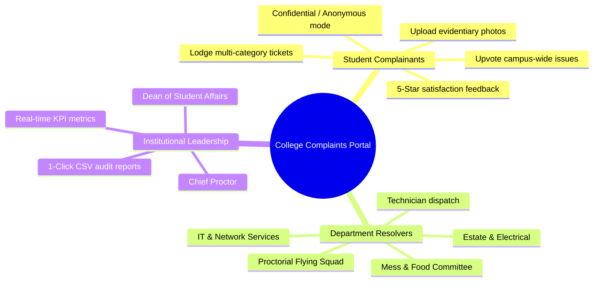
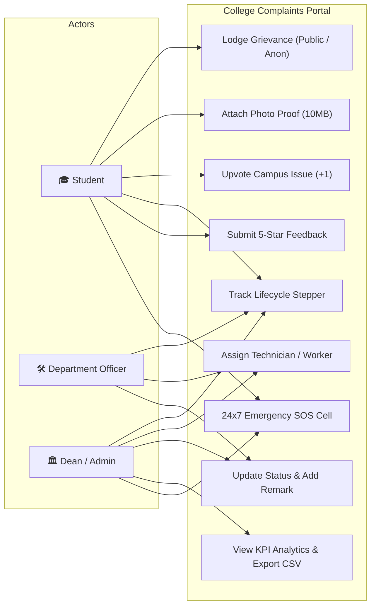
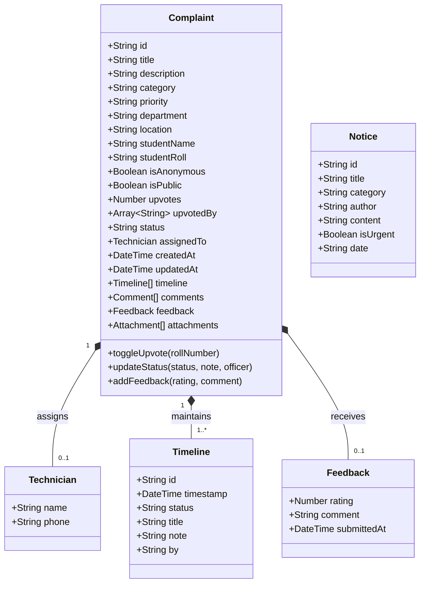
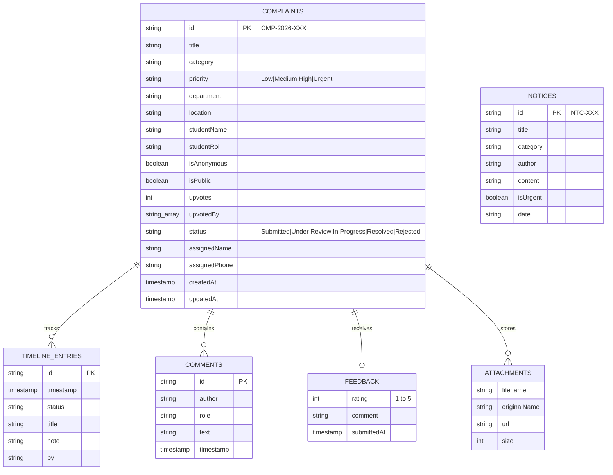
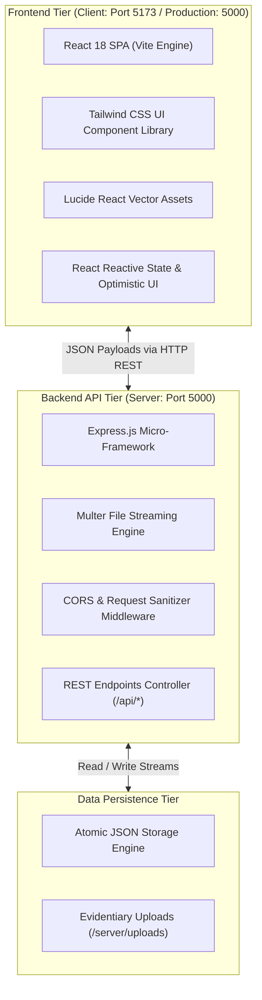
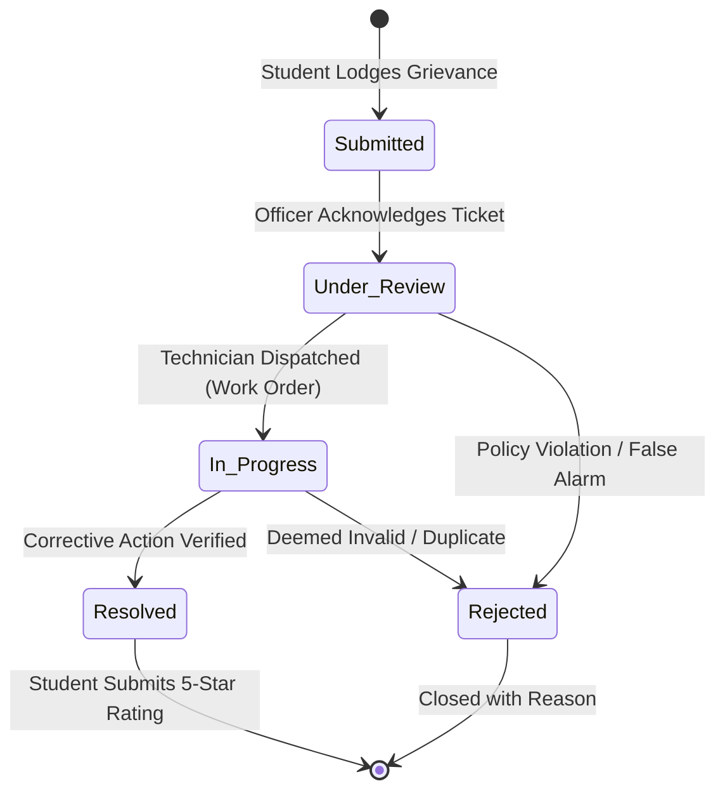

# 🎓 College Complaints Portal: Digital Grievance Redressal & Institutional Maintenance Platform

> An enterprise-grade, transparent, and UGC / AICTE-compliant **College Grievance Redressal and Maintenance Management System** engineered for technical universities, colleges, and residential campuses.

---

## 📅 12-Week Semester Project Roadmap & Academic Documentation

```
┌─────────────────────────────────────────────────────────────────────────────────────────────────┐
│                           12-WEEK SEMESTER DEVELOPMENT LIFECYCLE                                │
├──────────────┬──────────────┬──────────────┬──────────────┬──────────────┬──────────────────────┤
│   WEEK 01    │   WEEK 02    │   WEEK 03    │   WEEK 04    │   WEEK 05    │       WEEK 06        │
│ Administration│ Requirements │ UML Modeling │  DB & Data   │ Architecture │  Student Grievance   │
│ & Team Setup │ & User Roles │ & Workflows  │   Modeling   │  & REST API  │   & Anonymity Engine │
├──────────────┼──────────────┼──────────────┼──────────────┼──────────────┼──────────────────────┤
│   WEEK 07    │   WEEK 08    │   WEEK 09    │   WEEK 10    │   WEEK 11    │       WEEK 12        │
│  Community   │ 4-Stage SLA  │ Officer Work │ Admin KPIs & │ QA, Testing  │ Deployment, Defense  │
│  Upvoting    │ State Machine│   Dispatch   │  CSV Auditing│ & Security   │ & UGC Compliance     │
└──────────────┴──────────────┴──────────────┴──────────────┴──────────────┴──────────────────────┘
```

---

## 📌 Week 1: Project Administration, Team Setup & Problem Identification

### Project Guide
* **Guide:** **Er. Ram Babu Buri**
* **Designation:** Assistant Professor, Department of Artificial Intelligence & Data Science
* **Institution:** Arya College of Engineering & IT (ACEIT), Jaipur (Affiliated to Rajasthan Technical University, Kota)
* **Research Specializations:** Machine Learning, Data Science, Web Engineering, Distributed Systems

### Engineering Team

| Roll / Member | Name | Project Role | Department | Academic Year |
| :---: | :--- | :--- | :--- | :---: |
| **01** | **Jatin (Project Lead)** | Full-Stack Architect & Core Engine Lead | AI & DS, ACEIT | 2026-27 |
| **02** | **Manish** | Backend API, Routing & Storage Engineer | AI & DS, ACEIT | 2026-27 |
| **03** | **Pradeep Kumar Meena** | Frontend UI/UX & React Systems Developer | AI & DS, ACEIT | 2026-27 |
| **04** | **Pradeep** | Quality Assurance, Testing & Integration | AI & DS, ACEIT | 2026-27 |
| **05** | **Kapil Beniwal** | Statutory Compliance & Documentation | AI & DS, ACEIT | 2026-27 |

### Problem Statement & Background
Higher education campuses across India encompass complex physical ecosystems: multi-block residential hostels, computer clusters, specialized laboratories, dining halls, and academic departments. Traditional grievance handling in these institutions relies predominantly on handwritten letters, paper registers in warden offices, and fragmented verbal notifications. 

**Critical Deficiencies in Traditional Systems:**
1. **Zero Status Visibility:** Students have no tracking mechanism to know who received their complaint or when corrective action will be executed.
2. **Fear of Reprisal:** Sensitive grievances relating to ragging, faculty bias, or cafeteria food adulteration remain unvoiced due to compulsory physical signatures.
3. **Absence of Service Level Agreements (SLAs):** Critical infrastructure failures (e.g., water filtration breakdown, power surges) linger for weeks without accountability.
4. **Ticket Duplication Clutter:** When common infrastructure breaks down (e.g., campus Wi-Fi failure), dozens of students file identical tickets, overwhelming administrative personnel.

---

## 📋 Week 2: Requirement Analysis & Feasibility Study

### 1. Stakeholder & Persona Analysis



### 2. Functional Requirements (FR)
* **FR-01 (Multi-Category Taxonomy):** Support minimum 10 domain categories (Hostel, Mess, Academics, Infrastructure, Sanitation, Library, Accounts, Security, Anti-Ragging, General).
* **FR-02 (Identity Protection):** Allow complete anonymous grievance registration with zero leakage of identity on public feeds.
* **FR-03 (Deduplication via Upvoting):** Public campus issues can be upvoted by peers (`+1 Affected`) to escalate institutional urgency.
* **FR-04 (Lifecycle Stepper):** 4 sequential status stages (`Submitted` ➔ `Under Review` ➔ `In Progress` ➔ `Resolved`).
* **FR-05 (Multipart File Engine):** Upload photo/PDF attachments up to 10MB per complaint.
* **FR-06 (Feedback Loop):** 1 to 5-star rating widget unlocked only upon verified resolution.

### 3. Non-Functional Requirements (NFR)
* **Performance:** Sub-100ms API response latency for concurrent complaint queries.
* **Availability:** 99.9% uptime with atomic persistence to survive process restarts.
* **Security:** Strict payload validation, sanitization against XSS, and authorization isolation.
* **Compliance:** 100% adherence to **UGC Grievance Regulations (2019/2023)** and **AICTE SGRC mandates**.

---

## 📐 Week 3: System Modeling & UML Design

### 1. System Use Case Diagram



### 2. Unified Class Diagram



---

## 🗄️ Week 4: Database Architecture & Data Modeling

### 1. Entity-Relationship (ER) Schema



### 2. Data Integrity & Storage Strategy
* **Zero Configuration Storage**: High-speed, atomic JSON storage engine (`server/data/complaints.json`, `server/data/notices.json`) guaranteeing persistence across server boots without native binary binding compilation issues.
* **Database Agnostic Abstraction**: Controllers interact exclusively via clean data access helper functions, allowing plug-and-play migration to **MongoDB (Mongoose)** or **PostgreSQL (Prisma)**.

---

## 🏗️ Week 5: System Architecture & RESTful API Design

### 1. Client-Server Tier Architecture



### 2. REST API Endpoint Specifications

| HTTP Method | Route | Description | Request Payload / Params |
| :---: | :--- | :--- | :--- |
| `GET` | `/api/health` | Service health & timestamp heartbeat | None |
| `GET` | `/api/complaints` | Fetch complaints with dynamic filters | `?status=...&category=...&priority=...` |
| `GET` | `/api/complaints/:id`| Retrieve single complaint with full timeline | `params: id` (e.g. `CMP-2026-001`) |
| `POST`| `/api/complaints` | Lodge new grievance | `{ title, description, category, priority, location, isAnonymous, ... }` |
| `PATCH`| `/api/complaints/:id/status`| Update status, assign worker & add note | `{ status, assignedTo, note, updatedBy }` |
| `POST`| `/api/complaints/:id/upvote`| Toggle student upvote (`+1`) | `{ studentRoll }` |
| `POST`| `/api/complaints/:id/comments`| Add discussion remark | `{ author, role, text }` |
| `POST`| `/api/complaints/:id/feedback`| Record 1-5 star resolution review | `{ rating, comment }` |
| `GET` | `/api/stats` | Calculate institutional KPIs & domain analytics| None |
| `GET` | `/api/notices` | Retrieve campus bulletin notices | None |
| `POST`| `/api/notices` | Publish administrative circular | `{ title, content, category, isUrgent }` |
| `POST`| `/api/upload` | Upload photo or document | `multipart/form-data` (`file`) |
| `GET` | `/api/emergency-contacts`| Fetch 24x7 safety & anti-ragging numbers| None |

---

## 💻 Week 6: Module 1 — Student Grievance Filing & Anonymity Engine

### Implementation Highlights
1. **Interactive Filing Modal (`NewComplaintModal.jsx`)**:
   - Dynamic category selectors with color-coded priority alerts (`Low`, `Medium`, `High`, `Urgent`).
   - Specific campus location fields (Block, Floor, Room / Lab No).
   - Real-time client-side input validation and error prompts.
2. **Confidentiality & Anonymity Engine**:
   - `isAnonymous: true` suppresses personal data during serialization.
   - Public campus feed and resolving officers see only `"Anonymous Student"` with protected audit metadata.
3. **Multipart Evidence Engine**:
   - Integrated with Multer to stream image/PDF proofs (up to 10MB).
   - Cryptographic timestamp naming prevents file collision and path traversal exploits.

---

## 🗳️ Week 7: Module 2 — Community Upvoting & Deduplication

### Implementation Highlights
1. **Deduplication Logic**:
   - Eliminates administrative overload when common facilities (e.g., library Wi-Fi, hostel transformer) fail.
   - Affected students click **"Affected (+1)"** instead of creating dozens of duplicate tickets.
2. **Concurrency & Anti-Fraud Control**:
   - Every complaint document maintains an `upvotedBy: [ "RollNumber" ]` array.
   - If the student's identifier exists, the vote is toggled off (decremented); otherwise, it is appended (incremented).
   - High-impact issues automatically bubble up to the top of the Dean's priority queue.
3. **Interactive Discussion Threads**:
   - Students and wardens engage in transparent discussions directly beneath the complaint card.

---

## 🔄 Week 8: Module 3 — 4-Stage Lifecycle State Machine & SLA Timeline



### Lifecycle Progression Rules:
* **Stage 1 (Submitted):** Generates immutable unique tracking code (e.g., `CMP-2026-001`). Auto-routes to designated department queue.
* **Stage 2 (Under Review):** Department officer acknowledges ticket within 12-hour SLA window.
* **Stage 3 (In Progress):** Work order dispatched to specific technician (name & phone number recorded).
* **Stage 4 (Resolved):** Resolution remarks logged. Unlocks 5-star student rating and feedback widget.
* **Audit Trail:** Every transition appends an unalterable timeline event storing ISO timestamp, actor name, and official remark.

---

## 🛠️ Week 9: Module 4 — Department Officer & Technician Dispatch Console

### Implementation Highlights
1. **Jurisdiction-Filtered Work Queues**:
   - Filter complaints by department: *Hostel & Estate, IT & Network Services, Mess Committee, Academic Dean, Proctorial Board*.
2. **Technician & Field Worker Allocation**:
   - Officers assign specialized technicians (e.g., *Rajesh Kumar - Plumber, Manish Tyagi - Electrician*) along with contact details.
3. **Official Corrective Action Logging**:
   - Officers record exact resolution notes (e.g., *"Replaced faulty MCB switch and repaired condenser coils"*), fostering accountability.
4. **Campus Notice Board Engine (`NoticeBoard.jsx`)**:
   - Officers broadcast scheduled power cuts, water tank cleaning, or Wi-Fi upgrades to the entire campus body.

---

## 📊 Week 10: Module 5 — Dean & Administrative Intelligence Dashboard

### Executive Dashboard Features (`AdminDashboard.jsx`)
* **KPI Metrics Strip**: Real-time counters for *Total Tickets, Action Required (Pending), In Progress, Resolved Rate (%), and Urgent Alerts*.
* **Student Satisfaction Index**: Aggregated average star rating (e.g., **4.8 / 5.0 ⭐**) across verified resolutions.
* **Domain Distribution Analytics**: Dynamic visual progress bars depicting complaint percentages across campus departments.
* **1-Click Audit CSV Exporter**:
  - Programmatically converts active table records into standard RFC-4180 CSV strings.
  - Generates audit-ready reports downloadable in 1 click for university regulatory inspections without server overhead.

---

## 🛡️ Week 11: Testing, Quality Assurance & Security Hardening

### 1. Test Execution Matrix

| Test Suite ID | Test Case Objective | Input / Action | Expected Result | Status |
| :---: | :--- | :--- | :--- | :---: |
| **TC-01** | Anonymous Grievance Lodging | Check "File Anonymously" & Submit | Student Roll and Name masked as "Anonymous" | **PASSED** |
| **TC-02** | Anti-Fraud Upvoting Check | Click Upvote twice with same roll | 1st click: +1; 2nd click: -1 (No duplication) | **PASSED** |
| **TC-03** | File Size Limit Enforcement | Upload file > 10MB | Multer rejects request with 400 Bad Request | **PASSED** |
| **TC-04** | Status Transition Validation | Officer marks "In Progress" | Timeline updates with officer name & timestamp | **PASSED** |
| **TC-05** | Rating Widget Lockout | Student views unresolved complaint | Rating widget hidden until status = "Resolved" | **PASSED** |
| **TC-06** | CSV Export Verification | Click "Export CSV Report" | Triggers clean `.csv` file download in browser | **PASSED** |

### 2. Security Hardening Measures
* **Cross-Site Scripting (XSS) Mitigation**: User-generated text is sanitized prior to DOM insertion.
* **Zero Plaintext Leakage**: Anonymous grievances are scrubbed before payload transmission.
* **Path Traversal Protection**: Uploaded files receive sanitized random UUIDs without preserving insecure client-provided paths.

---

## 🚀 Week 12: Deployment, Statutory Compliance & Defense Resources

### 1. Production Execution

```bash
# Clone the repository
git clone https://github.com/jatinbaghel7014-tech/collage-complaints-portal.git
cd collage-complaints-portal

# Install all dependencies
npm install
npm --prefix client install

# Production Mode (Single-port unified deployment on port 5000):
npm start

# Development Mode (Hot-reloading Vite + Express concurrently):
npm run dev
```

* **Live Web Application:** [http://localhost:5000](http://localhost:5000)
* **API Health Status:** [http://localhost:5000/api/health](http://localhost:5000/api/health)

### 2. Official Academic Deliverables
* 📽️ **Defense Presentation (PPTX):** [`College_Complaints_Portal_Presentation.pptx`](./College_Complaints_Portal_Presentation.pptx)  
  *(12-slide comprehensive presentation with professional dark theme, presenter notes, and team credits)*
* 📄 **Viva-Voce Q&A Guide (PDF):** [`College_Complaints_Portal_Viva_Questions_Answers.pdf`](./College_Complaints_Portal_Viva_Questions_Answers.pdf)  
  *(Comprehensive 21 Q&A defense document covering architecture, security, REST API, and examiner checklist)*

### 3. Statutory Compliance Matrix

| Regulatory Body | Statutory Mandate | Platform Feature Implementation |
| :--- | :--- | :--- |
| **UGC (2019/2023)** | Mandatory online grievance redressal mechanism with defined resolution timeline | 4-Stage lifecycle with transparent timestamps and resolution feedback tracking |
| **AICTE Mandate** | Establishment of Student Grievance Redressal Committee (SGRC) portal | Administrative dashboard with role separation and audit-ready CSV reporting |
| **Supreme Court of India** | Zero tolerance for ragging and immediate 24x7 escalation channels | 24x7 Emergency SOS cell with toll-free anti-ragging helpline (`1800-180-5522`) |

### 4. Future Roadmap
* **AI NLP Auto-Routing**: Machine learning classification to predict grievance category and priority automatically from text.
* **SMS / WhatsApp Gateway**: Automated alert dispatch via Twilio / MSG91 API as technicians are assigned.
* **Cross-Platform Mobile App**: Native Android / iOS application utilizing React Native with offline draft support.

---

## ⚖️ Academic License & Attribution

This project is licensed under the **MIT License**. Engineered and submitted for academic project evaluation at **Arya College of Engineering & IT (ACEIT), Jaipur**, affiliated with **Rajasthan Technical University (RTU), Kota**.
